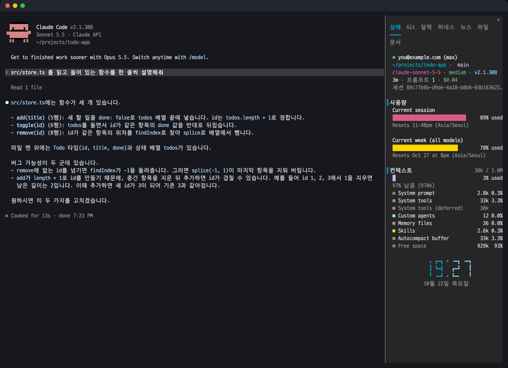
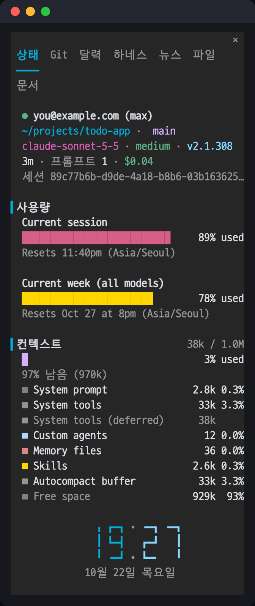
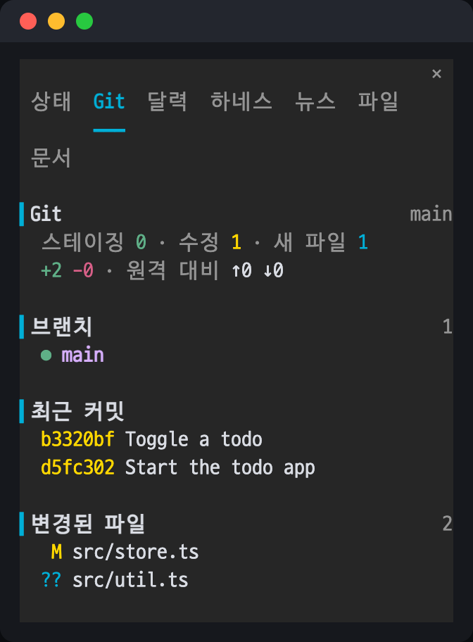
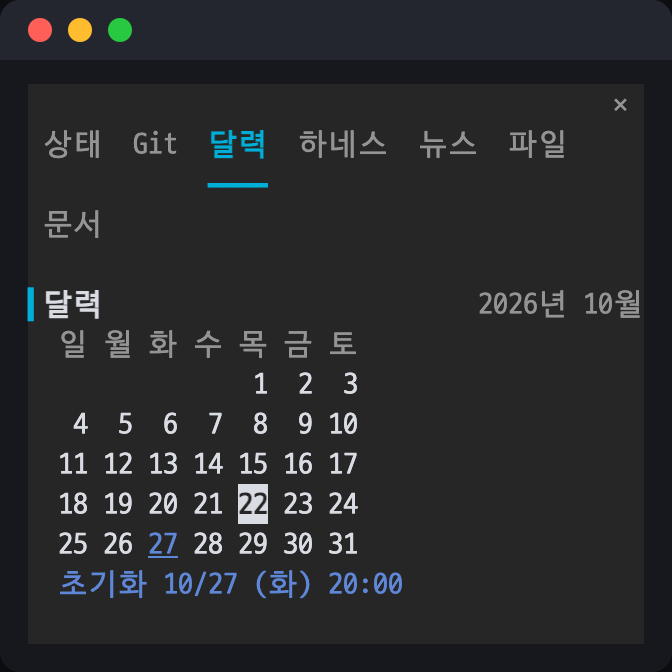
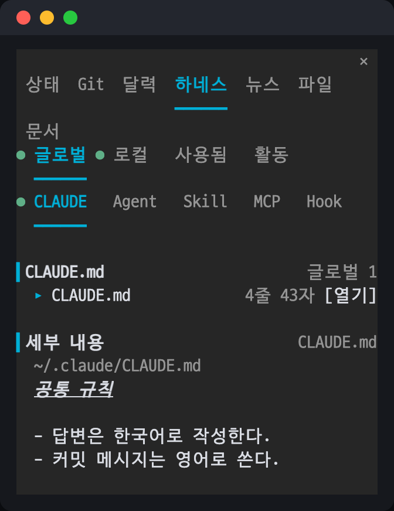
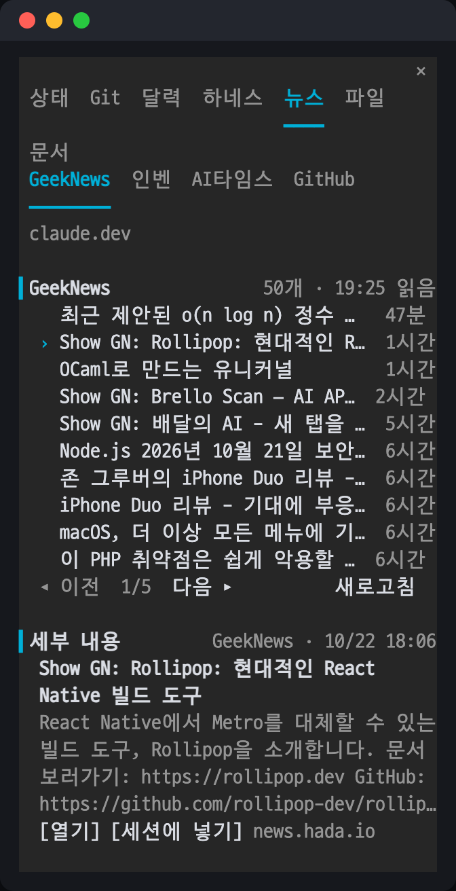
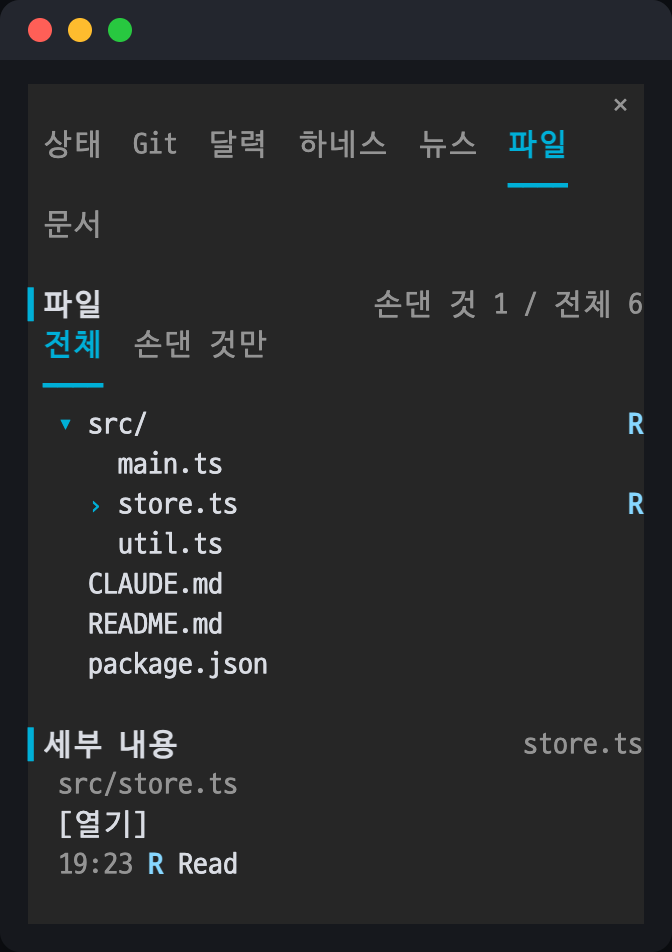
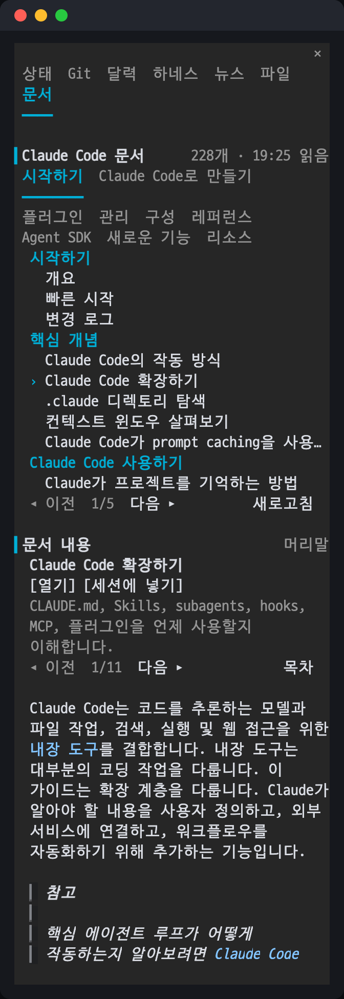

# status-panel

Claude Code 세션 옆에 상태 패널을 띄우는 모드입니다. 상태 줄에 나오는 정보(계정 · 위치 · 모델 · 컨텍스트 · 사용량 한도)를 패널 하나에 모아 보여 주고, 탭을 바꿔 가며 Git 상태, 달력, 하네스(`~/.claude` 와 프로젝트의 설정), 뉴스, 프로젝트 파일, Claude Code 한국어 문서를 확인할 수 있습니다.



## 설치

터미널에서 연 Claude Code 세션의 프롬프트에 다음 명령을 입력합니다.

```
/plugin install status-panel --marketplace LizeLing/status-panel
```

마켓플레이스를 추가할지 물으면 `y` 를 누르고, 설치 범위를 고릅니다(user 범위를 권장합니다). 이어서 나오는 설정 화면에서 `[열기]` 버튼이 파일을 열 앱을 정할 수 있습니다. 비워 두면 macOS 기본 앱으로 엽니다.

셸에서 설치하려면 다음 명령을 실행합니다.

```
claude plugin install status-panel --marketplace LizeLing/status-panel
```

데스크톱 앱에서는 프롬프트 입력창 옆의 + → Plugins → Add marketplace 에 `LizeLing/status-panel` 을 입력한 뒤, Add plugin 으로 설치합니다.

## 패널 열기와 조작

- 세션이 시작되면 패널이 저절로 열립니다. 패널을 닫았다면 `/status-panel` 명령으로 다시 엽니다.
- 터미널이 전체 화면 모드(설정의 `"tui": "fullscreen"`)이고 너비가 110칸 이상이면 패널이 대화 오른쪽에 붙습니다. 그렇지 않으면 프롬프트 위에 나타납니다.
- 전체 화면 모드에서는 탭과 버튼을 마우스로 누를 수 있습니다.
- 키보드로 다룰 때는 `ctrl+x` 다음 `Tab` 으로 패널에 포커스를 옮깁니다. 포커스가 있는 동안 `Tab` 으로 버튼 사이를 이동하고, `Enter` 로 누르고, 화살표 키로 패널을 스크롤합니다. `Esc` 를 누르면 포커스가 프롬프트로 돌아가고, `ctrl+x` 다음 `x` 를 누르면 패널이 닫힙니다.
- 탭이 패널 너비에 다 들어가지 않으면 다음 줄로 넘어가 표시됩니다.

## 탭

### 상태



대화 옆에 늘 띄워 두는 첫 화면입니다.

- 로그인한 계정과 요금제, 작업 폴더와 브랜치, 모델 · effort · Claude Code 버전을 보여 줍니다.
- 세션 시간, 보낸 프롬프트 수, 비용, 세션 ID 를 보여 줍니다.
- **사용량**: 현재 세션과 이번 주의 사용량 한도를 막대로 보여 주고, 초기화되는 시각을 함께 적습니다. 남은 양에 따라 막대 색이 초록 · 노랑 · 빨강으로 바뀝니다.
- **컨텍스트**: 컨텍스트 창을 얼마나 썼는지와, `/context` 처럼 시스템 프롬프트 · 도구 · 에이전트 · 메모리 파일 · 스킬 같은 항목별 토큰 수를 보여 줍니다.
- 아래쪽에는 큰 시계와 오늘 날짜가 나옵니다.

### Git



- 스테이징 · 수정 · 새 파일 수와 추가 · 삭제한 줄 수, 원격 브랜치보다 앞서거나 뒤처진 커밋 수를 보여 줍니다.
- 이어서 브랜치 목록, 최근 커밋, 변경된 파일(`M` 수정 · `??` 새 파일 등)을 나열합니다.

### 달력



- 이번 달 달력에 오늘을 표시합니다.
- 주간 사용량 한도가 초기화되는 날을 달력에 표시하고, 그 날짜와 시각을 아래에 적습니다.

### 하네스



`~/.claude`(글로벌)와 프로젝트(로컬)에 설정된 하네스를 종류별로 봅니다.

- 범위는 **글로벌 · 로컬 · 사용됨 · 활동** 이고, 종류는 **CLAUDE**(CLAUDE.md) · **Agent**(서브에이전트) · **Skill** · **MCP** · **Hook** 입니다.
- 항목을 누르면 아래 「세부 내용」에 파일 경로와 내용이 나옵니다. CLAUDE.md 와 스킬은 Markdown 으로 그리고, 훅은 실행하는 명령을 셸 문법에 맞춰 줄을 나눠 보여 줍니다.
- `[열기]` 를 누르면 그 파일을 설정한 앱(기본은 macOS 기본 앱)으로 엽니다.
- **사용됨** 은 이 세션에서 실제로 불러온 항목만 모아 보여 주고, 범위와 종류 앞의 `●` 는 이 세션에서 쓴 항목이 있다는 표시입니다.
- **활동** 은 이 세션의 도구 호출 수와 에이전트의 상태(실행 중 · 완료 · 실패 등)를 보여 줍니다.

### 뉴스



- GeekNews · 인벤 · AI타임스 · GitHub 트렌딩 · claude.dev 블로그를 골라 최신 글을 10개씩 넘겨 봅니다. 글마다 올라온 지 얼마나 지났는지 함께 적습니다.
- GitHub 트렌딩은 저장소 이름, 오늘 받은 별 수, 설명을 두 줄로 보여 줍니다.
- 글을 누르면 「세부 내용」에 제목과 요약이 나옵니다. `[열기]` 는 브라우저로 글을 열고, `[세션에 넣기]` 는 글 주소를 프롬프트 입력란에 넣습니다.

### 파일



- 프로젝트의 파일을 트리로 보여 줍니다. 폴더를 누르면 펼치거나 접습니다.
- 에이전트가 이 세션에서 만들고(`C`) · 읽고(`R`) · 고치고(`U`) · 지운(`D`) 파일에 표시를 붙입니다. Bash 명령으로 바뀐 파일도 명령 전후를 비교해 찾아냅니다.
- **전체** 와 **손댄 것만** 으로 목록을 거를 수 있고, 파일을 누르면 그 파일에 무슨 일이 언제 있었는지 「세부 내용」에 나옵니다.

### 문서



[Claude Code 한국어 문서](https://code.claude.com/docs/ko/overview)를 패널 안에서 읽습니다.

- 위쪽에는 사이트의 섹션(시작하기 · Claude Code로 만들기 · 플러그인 · 관리 · 구성 · 레퍼런스 · Agent SDK · 새로운 기능 · 리소스)이 탭으로 나오고, 고른 섹션의 페이지가 그룹 제목 아래에 12줄씩 나옵니다.
- 페이지를 누르면 아래에 제목과 한 줄 설명이 나오고, 본문을 Markdown 으로 그립니다. 긴 페이지는 `##` 제목마다, 그리고 약 2400자마다 나눠 「◂ 이전 · 다음 ▸」로 넘깁니다.
- `목차` 를 누르면 본문 자리에 페이지의 제목 목록이 나오고, 제목을 누르면 그 부분으로 바로 넘어갑니다.
- 본문에 있는 다른 문서 링크를 누르면 브라우저 대신 패널 안에서 그 문서로 넘어갑니다.
- `[열기]` 는 브라우저로 페이지를 열고, `[세션에 넣기]` 는 페이지 주소를 프롬프트 입력란에 넣습니다. 변경 로그처럼 사이트 밖에 있는 문서는 `[열기]` 로 봅니다.
- 본문이 패널보다 길면 패널에 포커스를 옮긴 뒤 화살표 키나 휠로 스크롤합니다.

## 설정

| 항목 | 설명 |
| --- | --- |
| `[열기]`로 여는 앱(`openWith`) | 하네스 탭의 `[열기]` 가 파일을 여는 앱 이름(예: `Visual Studio Code`). 비워 두면 macOS 기본 앱으로 엽니다. |

## 읽는 정보와 네트워크

패널이 읽고 실행하는 것은 다음과 같습니다. 어떤 정보도 외부로 보내지 않습니다.

- **명령**: `claude auth status`(계정), `git -C <작업 폴더> …`(Git 탭), `find`(파일 목록과 Bash 명령 전후 비교), `open`(`[열기]`).
- **파일**: `~/.claude` 와 프로젝트의 CLAUDE.md · 에이전트 · 스킬 · 설정 파일(하네스 탭). MCP 서버는 실행 명령과 URL(쿼리 문자열 제외)만 표시하고, 환경 변수와 헤더는 이름만 표시합니다.
- **기록**: 패널이 보이는 동안 `~/.claude/status-panel/<세션 id>` 에 마지막으로 확인한 시각을 기록합니다. 상태 줄 스크립트가 이 값을 읽어, 패널이 보일 때 같은 정보를 두 번 표시하지 않도록 할 수 있습니다.
- **네트워크**: 뉴스 탭은 탭을 열 때 각 사이트의 RSS 와 github.com/trending 페이지를 읽습니다. 문서 탭은 탭을 열 때 `code.claude.com/docs/_llms/ko.txt` 의 목록을, 페이지를 고를 때 그 페이지의 Markdown 을 읽습니다. 두 탭 모두 10분 동안은 다시 읽지 않으며, 「새로고침」을 누르면 바로 다시 읽습니다.

## 참고

- 화면의 문구는 한국어입니다.
- `[열기]` 버튼은 macOS 의 `open` 명령을 사용하므로 다른 OS 에서는 동작하지 않습니다.
- README 의 스크린숏은 예시 계정(`you@example.com`)과 예시 프로젝트(`~/projects/todo-app`)로 찍은 화면입니다. 뉴스 · 문서 탭의 내용은 찍은 날(2026-10-22)의 사이트 내용이고, 사용량 막대는 찍을 때의 실제 값입니다.
